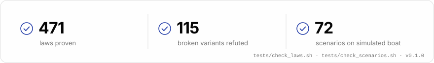

<p>
<picture>
  <source media="(prefers-color-scheme: dark)" srcset="assets/hero-dark.svg">
  
</picture>
</p>

<p align="center">
  <a href="#install"></a>
  
  <a href="LICENSE"></a>
</p>

Your laptop shouldn't run the test suite, the benchmark, or the sweep your agent just kicked off. **supercomputer**
sends them to a warm pool of [boat.dev](https://boat.dev) VMs shared by every repo on your machine, puts GPU jobs on
RunPod, and falls back to Modal when either can't take them. One scheduler places every batch, keeps the VMs busy
while there's work, and lets them go when there isn't.

- **One command from any repo.** A jobs file in, logs and a summary out. The repo's tree ships by hash, so a changed
  file costs only itself.
- **Warm, not cold.** A batch on a warm VM skips the start entirely; the pool grows only for work it can't clear.
- **Upgrades lose nothing.** Install new code and the running scheduler hands its VMs and queued items to it.
- **Proven.** Every decision lives in `supercomputer/rules/` as a plain function with laws a prover checks.

## Install

You need [uv](https://docs.astral.sh/uv/) (Python 3.12+), the [boat CLI](https://docs.boat.dev/cli-reference) signed
in with `boat login`, and optionally Modal (`modal token new`) and RunPod (`runpodctl`) for the fallbacks.

```sh
uv tool install git+https://github.com/monotykamary/supercomputer
```

Hacking on it? Link a checkout instead, the uv way of `bun link`: the command then runs your working tree.

```sh
git clone https://github.com/monotykamary/supercomputer && cd supercomputer
uv tool install --editable .
```

For updates while clients or a scheduler are running, use the reviewed-commit
[`ROLLOUT.sh`](ROLLOUT.sh) procedure rather than reinstalling a shared environment
or changing a live checkout. It stages an immutable version before switching the
entry point. See [journal migration and handoff](docs/result-journal-migration.md).

State lives in `~/.local/share/supercomputer` (or `$SUPERCOMPUTER_HOME`): `live/` holds the pool, the ledgers and
the caches; `repos/` holds configs for repos that don't carry their own.

## Run something

```json
[
  {"name": "hello", "cmd": "python3 hello.py"},
  {"name": "nproc", "cmd": "nproc && uname -sm"},
  {"name": "tests", "cmd": "python3 -c 'import sys; print(sys.version.split()[0])'"}
]
```

```sh
supercomputer image --build      # once per repo, and when its layers change
supercomputer run --jobs jobs.json --out runs/x
```

<p>
<picture>
  <source media="(prefers-color-scheme: dark)" srcset="assets/run-dark.svg">
  
</picture>
</p>

That's a real run on a warm VM: 11.7 s wall and no start. The same batch cold took 48.8 s, its one VM start
included. Each job's output lands in `runs/x/<name>.log`; `runs/x/summary.tsv` has its name, exit code, seconds and
where it ran, and `runs/x/backends.json` says why anything moved.

Native jobs can also return arbitrarily large **output files**: write regular files under
`$SUPERCOMPUTER_OUTPUT_DIR`. They are spooled by SHA-256 before job cleanup and downloaded,
with hash verification, to `runs/x/<name>.files/<relative-path>`. Do not embed large artifacts as
base64 in JSON or stdout. Large JSON returns are delivered as complete file references; small
returns are unchanged. See [output-file transport and result references](docs/result-files.md).

| Job field | |
| --- | --- |
| `name`, `cmd` | required; `cmd` runs under bash in `<repo>/<cwd>` |
| `cwd`, `env`, `timeout` | where, with what, for how long |
| `cpu`, `memory` | its shape; a job past 2 vCPUs gets its slots set aside on one VM |
| `image`, `vm_type` | an image the repo's config names; a fixed VM type (for timing claims) |
| `cpu_model` | exact agent-reported CPU model; requires `vm_type`, never falls back to other hardware |
| `distinct_vm_group` | batch-scoped group ID by default; each member uses a different VM, even after earlier members finish or the scheduler restarts |
| `distinct_vm_group_scope` | opt in with `"durable"`: share distinct-VM history across batches and clients of the same scheduler |
| `distinct_vm_group_generation` | optional nonblank generation from `open`/`get`; valid only with durable scope; pins this epoch and refuses expired or mismatched epochs |
| `gpu` | goes to RunPod, then Modal |
| `backend` | `boat`, `runpod` or `modal` only, no fallback |

## Durable distinct-VM groups (opt in)

For a multi-wave experiment, add a stable group name and durable scope to every member:

```json
[{"name":"rep-1","cmd":"./experiment","backend":"boat",
  "distinct_vm_group":"experiment-42/replicates","distinct_vm_group_scope":"durable"}]
```

The scheduler binds and permanently persists a generation at admission. All clients using that scheduler
share its VM history across batches, including completed members. Omit the scope to retain the existing
**batch-only** behavior unchanged. Durable jobs require the exact advertised capability
`distinct_vm_group_scope:"durable"` and `durable_distinct_vm_group_protocol:1`; the client refuses an
older scheduler **before uploading the tree or submitting**. These jobs never fall back to Modal.

Use the installed Python package to manage the lifecycle (JSON replies):

```sh
python3 -m supercomputer.boat distinct-groups open experiment-42/replicates
python3 -m supercomputer.boat distinct-groups get experiment-42/replicates
# Copy the returned generation exactly; optionally add it to each job as distinct_vm_group_generation.
python3 -m supercomputer.boat distinct-groups close experiment-42/replicates --generation GENERATION --ttl-s 3600
```

`open` returns the current unexpired epoch or creates one; submitting without a generation also opens/binds
one automatically. `get` observes without creating. Explicit `close` starts the TTL: members remain constrained
and further admission is allowed through the grace period, until `expires_at`. Repeating close with the same
generation and TTL is idempotent; changing the TTL cannot extend it. After expiry, open or a **new unpinned**
submission creates a fresh generation. A pinned old request is refused; already queued work stays bound to
its admitted generation and must not silently join the fresh one. Coordinate close with all producers.

An open group has no automatic expiry. This is durable placement metadata, **not parked or reserved VMs**;
normal busy/release rules still apply. Group generations are experiment epochs, not the agent's per-VM lease
boot/epoch fencing pair. See [multi-client lifecycle details](docs/multi-client.md#durable-distinct-vm-groups).
## How it works

<p>
<picture>
  <source media="(prefers-color-scheme: dark)" srcset="assets/flow-dark.svg">
  
</picture>
</p>

**One scheduler per pool.** Every batch goes to a scheduler on your machine (127.0.0.1:8790), started by the first
client and gone two idle minutes after its last work. If `live/controller.json` exists, clients use that controller
by default; `SUPERCOMPUTER_LOCAL=1` is the explicit opt-in to a local scheduler. It alone holds the VMs. After a laptop sleep it renews them and
adopts any left without an owner.

**Capacity, cheapest first:** a free slot on a warm VM, then a lower class's slot, then a free start, then a paid one.
The pool grows only for queued work the warm VMs can't clear within the hour (a gate's within 15 minutes), never on
a timer, and a circuit breaker stops every start when recent ones keep failing.

**Warm agents.** Each VM runs a small agent behind boat's token-gated HTTPS. A batch that finds one free sends a single
request: the tree by id, then the jobs. The agent keeps every file it was sent by content, so the next tree costs only
its changed files.

**Fallback.** An item boat fails (a VM lost, a row missing, no VM ready) is retried on another VM, up to 3 times;
only then does it run once on Modal. GPU jobs go to RunPod first, then Modal.

**Busy, never parked.** A VM with nothing to run is released and stops 60 s later. VMs above the floor run filler for
at most 45 minutes after their last real work. One account, no metering tricks, a reserve of free starts left for your
other projects.

## Classes

Higher classes take lower classes' slots at once; within a class, clients are served round-robin.

| `--class` | For | Gets |
| --- | --- | --- |
| `interactive` | quick checks | a slot at once (a filler's or a sweep's item is re-queued) |
| `gate` | bars and test suites | lower slots at once, then the VMs that finish it within 15 min |
| `submission` | experiments | up to 8 VMs per client while others wait, a filler's slot after 45 s |
| `sweep`, `filler` | the treadmill's chains and soundness fill | whatever is left |

A small batch defaults to `interactive`, a bigger one to `submission`.

## A repo's config

A repo works with no config: its directory name, a base image (curl, git, build-essential) and Modal's slim image.
Add `supercomputer.toml` at its root for more:

```toml
name = "myrepo"                      # /src/myrepo (read-only) and /work/myrepo on a VM
[boat]
vm_type = "large"
path = ["~/.bun/bin"]                # before every job's PATH
ignore = ["**/node_modules/**"]      # on top of .gitignore
layers = [{name = "tools", script = "curl -fsSL https://bun.sh/install | bash"}]
[[cache]]                            # a build cache, keyed by its inputs' hash
name = "build"
dir = "lib"
modules = ["Core"]
inputs = "{m}.lean"
outputs = "{m}.olean"
[gpu]
image = {apt = ["git"], run = ["pip install torch"]}
```

Every key is in [`supercomputer/config.py`](supercomputer/config.py)'s docstring.

## Proven, not just tested

<p>
<picture>
  <source media="(prefers-color-scheme: dark)" srcset="assets/laws-dark.svg">
  
</picture>
</p>

Every decision the tool makes (an item's fate, a VM's owner, when to start, hold or release, the handoff) is a plain
function in [`supercomputer/rules/`](supercomputer/rules/) with its laws written beside it as `# gdp: law` comments.
[gdp-wired](https://gdpwired.dev) proves each law from every state the laws allow, and
`tests/broken_*.py` keeps the bugs they were written for, each one refuted by a run that breaks it.
[`rules/COVERAGE.md`](supercomputer/rules/COVERAGE.md) accounts for every function: a rule, or I/O and why.

```sh
tests/check_laws.sh        # the laws, proven and checked (a good pre-commit hook)
tests/check_scenarios.sh   # unit tests, then the real scheduler against simulated boat
```

Both run their heavy work on boat, through supercomputer itself.

## For agents

`supercomputer --skill` prints a short guide for coding agents, with live values filled in: the pool right now, the
day's free starts, the classes and the terms. To have your agents use it, put this in `CLAUDE.md` or `AGENTS.md`:

```md
Run everything but the extremely light (tests, builds, benchmarks, sweeps) through `supercomputer`.
Read `supercomputer --skill` before first use in a session.
```

## Commands

| | |
| --- | --- |
| `run --jobs F --out D` | a batch: `--class`, `--backend`, `--timing`, `--vm-type`, `--data DIR[:DEST]`, `--env K=V` |
| `image [--build]` | the repo's boat image, from its config's layers or hooks |
| `status`, `starts`, `digest` | the pool; the starts ledger; VM-hours and dollars by class |
| `reap` | dead clients' leases, VMs left up past their time, orphaned Modal apps and pods |
| `policy [k=v ...]` | the scheduler's knobs, in force within a tick |
| `queue add\|ls\|results` | the treadmill's queue of ideas |
| `store push\|pull\|ls ...` | volumes on boat: named snapshots, sha256 manifests, pulls cached by hash |
| `volumes ...`, `runpod ...` | a Modal volume straight to boat; RunPod's pods |

`/status` serves an immutable published view without waiting on the scheduler
lock. Its additive `status_snapshot` metadata reports capture/publication time,
age and readiness; blocked refreshes leave the last view explicitly aged. See
[status snapshots](docs/status-snapshot.md).

## More

- [docs/scheduling.md](docs/scheduling.md): the scheduling policy in full, growth and shrink, preemption, restarts,
  the handoff, boat's terms.
- [docs/internals.md](docs/internals.md): the layout, warm agents, the blob cache, every environment variable.

## License

MIT. If it saves you time, [sponsor the work](https://github.com/sponsors/monotykamary).
